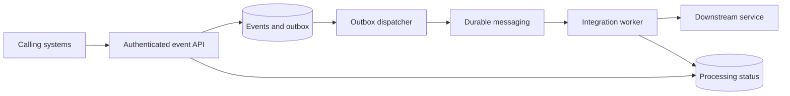

# Platform Services interview study plan

Prepared for Agilent's Digital Solutions Engineer - Platform Services role on 2 November 2026.

Target postings: [4039669](https://agilent.wd5.myworkdayjobs.com/Agilent_Careers/job/Singapore-Yishun/Digital-Solutions-Engineer---Platform-Services_4039669) and [4039991](https://agilent.wd5.myworkdayjobs.com/Agilent_Careers/job/Singapore-Yishun/Digital-Solutions-Engineer---Platform-Services_4039991).

This guide follows the published responsibilities, not a prediction of Agilent's interview questions or actual team architecture. The examples are fictional and contain no employer system details. Technologies studied here are preparation topics, not claims of professional experience.

## 1. What the job is asking for

The central responsibility is to build and operate backend services that connect applications, enterprise systems, operational technology, and data platforms.

| JD responsibility | What to demonstrate in an interview |
| --- | --- |
| Reusable backend services and APIs | Clear contracts, maintainable boundaries, compatibility, and appropriate service decomposition. |
| Enterprise integration | Handling different schemas, unavailable dependencies, asynchronous workflows, and consistent identities. |
| Cloud-native engineering | Container deployment, automated checks, configuration, scaling, and rollback. |
| Security and reliability | Authentication, authorization, safe retries, fault tolerance, and recoverability. |
| Monitoring and operational support | Useful logs, metrics, traces, health checks, and a structured incident investigation. |
| Cross-functional engineering | Explaining assumptions and trade-offs, reviewing designs, and agreeing ownership with other teams. |

### Required skills versus the technology list

The required profile includes backend development, API and database knowledge, programming proficiency, and familiarity with cloud and distributed architecture. The posting welcomes multiple career stages.

Its technology environment includes .NET, Python, and Node.js, with Node.js marked preferred. It also lists REST, GraphQL, gRPC, OAuth/OIDC, Azure, AWS, containers, messaging, databases, and monitoring products. Do not interpret that list as a requirement to be expert in every product.

Prioritize Node.js, REST, relational data correctness, integration reliability, identity, and cloud deployment concepts. Understand the other products well enough to discuss when they help. MAUI is not part of this Platform Services JD.

## 2. Eight-hour schedule

There are seven hours of topic study and one hour of design practice. Breaks are additional. Split the work across two evenings, or spread the blocks over several days.

| Session | Topic | Minutes | Output |
| --- | --- | ---: | --- |
| Day 1, A | Backend APIs and service boundaries | 75 | A request-flow diagram and an API contract. |
| Day 1, B | Enterprise integration | 60 | A protocol and interaction decision table. |
| Day 1, C | Messaging and failure handling | 60 | A delivery-failure timeline. |
| Day 1, D | Databases and consistency | 45 | A transaction and outbox sketch. |
| Day 2, E | Authentication and API security | 60 | A token-validation and authorization flow. |
| Day 2, F | Cloud deployment and CI/CD | 60 | An Azure deployment and rollback outline. |
| Day 2, G | Reliability and observability | 45 | An incident investigation checklist. |
| Day 2, H | Architecture communication | 15 | One short architecture decision record. |
| Day 2, I | Design exercise and mock interview | 60 | A complete service design and spoken walkthrough. |
| Total | | 480 | Eight hours. |

For each topic, explain the idea aloud before looking at the answer outline. Record anything you cannot explain clearly and revisit those gaps during the final session.

## 3. Session A: Backend APIs and service boundaries

Time allocation: 15 minutes for runtime fundamentals, 25 for API design, 20 for service boundaries, and 15 for questions.

### Runtime fundamentals

Understand how an HTTP request moves through routing, validation, authentication, authorization, business logic, database access, and response handling. Middleware order affects behavior, so explain where each responsibility belongs.

Node.js can handle overlapping I/O without assigning a JavaScript thread to every request. CPU-heavy work on the event-loop thread can still delay other requests. Marking a function `async` does not move its computation to another thread. Consider workers or separate processing services for expensive transformations. See [Node.js: avoiding event-loop blocking](https://nodejs.org/en/learn/asynchronous-work/dont-block-the-event-loop).

Review errors against the Express version in use. Express 5 forwards rejected promises returned by handlers to error handling; older patterns may require explicit forwarding. Return a consistent error structure and avoid exposing internal stack traces. See [Express error handling](https://expressjs.com/en/guide/error-handling/).

### Design a usable API contract

Start with the consumer and business operation. For a fictional event service, define `POST /v1/events` and `GET /v1/events/{id}`.

Decide the following before discussing implementation:

- Required fields, supported types, timestamps, units, maximum payload size, and validation errors.
- Who may submit an event and who may read its status.
- Whether success means stored, accepted for processing, or fully processed.
- What a repeated request returns and how conflicting reuse of a request key is handled.
- How consumers discover processing status and recover after a timeout.

Use HTTP status codes intentionally. `201 Created` fits creation of a resource. `202 Accepted` fits work accepted for later completion. It does not promise that processing has finished. Use `400` for invalid requests, `401` for missing or invalid authentication, `403` for insufficient permission, `409` for a state conflict, `429` for rate limits, and `503` for temporary service unavailability when appropriate.

### Choose service boundaries

A modular application can be the right starting point when one team owns a tightly related workflow. Separate services introduce deployment, network, data-consistency, and support costs.

Consider splitting a service when there is an independent business boundary, scaling requirement, security boundary, or ownership need. Explain why the split is useful rather than treating microservices as the default.

Protect compatibility through additive changes where possible. Renaming fields, changing types, and changing the meaning of a success response can break clients. Document deprecation and migration before removing old behavior.

### Practice

Question: How would you design one API consumed by several manufacturing applications?

Answer outline: identify consumers and operations; agree the contract; authenticate callers; enforce permissions; validate at the boundary; isolate business logic; use bounded dependency calls; document errors and compatibility; add operational telemetry and tests.

Done when: you can draw the request flow, explain `201` versus `202`, and name one reason to keep a modular application together.

## 4. Session B: Enterprise integration

Time allocation: 15 minutes for protocols, 20 for system boundaries, 15 for failure scenarios, and 10 for questions.

### Choose the interaction before the product

| Option | Useful when | Cost or limitation to discuss |
| --- | --- | --- |
| REST | Resource-oriented APIs, broad client support, and straightforward HTTP operations. | Consumers may need several requests for complex views. |
| GraphQL | Clients need flexible queries across a graph of data. | Query complexity, authorization, caching, and resolver performance require deliberate design. |
| gRPC | Typed service-to-service contracts and streaming are valuable. | Browser integration and operational tooling can require additional infrastructure. |
| Synchronous call | The caller needs an immediate decision to continue. | The caller depends on the downstream system's latency and availability. |
| Asynchronous message | Work can complete later or needs buffering and independent consumers. | Completion is delayed and status, duplicate handling, and recovery become explicit concerns. |

The protocol comparison is a design exercise, not an instruction to use every protocol in one solution. Review [GraphQL's overview](https://graphql.org/learn/) and [gRPC core concepts](https://grpc.io/docs/what-is-grpc/core-concepts/) if either is unfamiliar.

### Protect system boundaries

An integration adapter translates another system's schema and failure behavior into your service's contract. Keep external field names and special cases from spreading through all business logic.

Agree record ownership, stable identifiers, units, time zones, schema versions, and reconciliation rules. A timestamp without a defined time zone can silently corrupt a cross-site timeline.

Give every remote call a timeout and a bounded concurrency policy. Propagate an overall request deadline where practical. Retries must fit inside that deadline. Cache only where the freshness and invalidation rules are acceptable.

### Practice

Scenario: An enterprise system is unavailable for two hours, but equipment continues producing events.

Explain where events can be durably buffered, how much backlog is acceptable, what happens when capacity is exhausted, and how recovery avoids overwhelming the destination. If an operation cannot safely continue without that system, explain the rejection or pause behavior instead.

Done when: you can choose synchronous versus asynchronous integration and explain both normal operation and an outage.

## 5. Session C: Messaging and failure handling

Time allocation: 15 minutes for messaging models, 20 for delivery failures, 15 for recovery policies, and 10 for questions.

### Product orientation

Use these as conceptual starting points, then check the specific product and configuration:

- A work queue distributes tasks among competing consumers.
- Publish/subscribe delivers events to independently interested subscribers.
- Kafka is commonly used as a partitioned event log with retention and replay.
- RabbitMQ supports brokered messaging and routing, including queue-based workflows.
- Azure Event Hubs supports event-stream ingestion. Azure Service Bus is another service worth recognizing when discussing enterprise queues and topics.

Avoid claiming every broker guarantees global ordering or exactly-once business effects. Retention, acknowledgements, durability, and ordering depend on the chosen system and configuration.

### Learn the failure timeline

At-least-once delivery allows redelivery. A consumer might commit its database change, crash before acknowledging the message, and then receive the same message again. Publisher confirms and consumer acknowledgements protect different parts of delivery; neither alone proves that the business action happened exactly once. See [RabbitMQ's reliability guide](https://www.rabbitmq.com/docs/reliability).

Design consumers to recognize duplicates using a stable event identifier and a durable record. Write the deduplication record and business change in the same transaction where possible. For external side effects, pass a supported idempotency key or provide reconciliation.

### Recovery policies

- Retry transient failures with a limit, exponential backoff, and jitter. Do not retry permanent validation failures indefinitely.
- Define which failures enter a dead-letter queue and who owns investigation and replay.
- Preserve event identity during replay. Sending a new identifier can defeat deduplication.
- Limit consumer concurrency and watch backlog age, not just backlog count.
- Define the required ordering scope, such as per equipment identifier. Global ordering often costs more than the business needs.

### Practice

Draw this sequence: receive event, update database, commit, crash, redelivery. Explain why acknowledging before commit risks loss and acknowledging after commit permits duplicates.

Done when: you can explain duplicate delivery, safe retry, and poison-message handling without promising universal exactly-once processing.

## 6. Session D: Databases and consistency

Time allocation: 15 minutes for database fundamentals, 15 for consistency patterns, and 15 for questions.

### Database fundamentals

Choose relational storage when constraints, relationships, and transactions fit the domain. Consider document storage for appropriate document-oriented access patterns. Use Redis for a defined caching or coordination purpose, with clear expiry, durability, and invalidation assumptions.

For SQL, review parameterized statements, indexes aligned with query patterns, transaction scope, lock contention, and connection lifecycle. A larger pool can increase database contention rather than improve throughput. Budget connections across all service replicas.

Isolation controls which concurrent changes a transaction can observe. Know the difference between reading committed data and requiring a result equivalent to serial execution. Serializable transactions may need retry after a serialization failure; they do not remove all operational trade-offs. See [PostgreSQL transaction isolation](https://www.postgresql.org/docs/current/transaction-iso.html).

### Idempotency and the outbox

For an API request, use a client-scoped idempotency key and a request fingerprint. An exact repeat should resolve to the original operation. Reusing a key for different content should be rejected. Enforce uniqueness in shared durable storage so concurrent instances cannot both accept it.

The transactional outbox addresses the gap between storing business data and publishing an event. Commit the business change and an outbox record together. A separate dispatcher publishes pending records and retries after failures. Consumers still need duplicate handling because publication can happen before the dispatcher records completion. Microsoft's [transactional outbox example](https://learn.microsoft.com/en-us/azure/architecture/databases/guide/transactional-out-box-cosmos) uses Cosmos DB; a relational implementation uses the same local-transaction principle with different mechanics.

Done when: you can explain what happens when the database commits but the broker is unavailable, and what remains eventually consistent.

## 7. Session E: Authentication and API security

Time allocation: 15 minutes for identity concepts, 20 for token and permission checks, 15 for service security, and 10 for questions.

### Separate identity from permission

Authentication establishes identity. Authorization decides whether that identity may perform a particular action on a particular resource.

OAuth 2.0 provides an authorization framework. OpenID Connect adds an identity layer. An ID token is not a substitute for an access token when calling a protected API. A JWT is a token format, not a guarantee of trust. See [Microsoft identity-platform access tokens](https://learn.microsoft.com/en-us/entra/identity-platform/access-tokens).

For JWT access tokens intended for your API, use maintained middleware to validate the signature, trusted issuer, intended audience, validity period, and acceptable algorithms. Then enforce the required scopes or application roles and resource-level permissions. Merely decoding a token is not validation.

### Distinguish caller types

A browser application commonly uses an authorization-code flow with PKCE. A background service needs a service identity rather than a fabricated human login. On Azure, understand where managed identity can replace stored credentials for supported resources. Review [OAuth client credentials](https://learn.microsoft.com/en-us/entra/identity-platform/v2-oauth2-client-creds-grant-flow) and [managed identity](https://learn.microsoft.com/en-us/entra/identity/managed-identities-azure-resources/overview).

Never trust a caller-supplied user identifier as proof of identity. Check resource ownership or organizational boundaries on the server. CORS controls browser cross-origin access; it does not authenticate a caller or stop non-browser clients.

Use TLS, least-privilege database accounts, bounded payloads, secret management, rotation, and rate limits. Do not log access tokens, credentials, or unnecessary sensitive payloads. Keep security audit events distinct from ordinary debug output.

### Practice

Question: A valid user token reaches an endpoint but belongs to a user from another organization. What happens?

Answer outline: validate the token for this API, obtain trusted identity claims, check the action and resource boundary, reject unauthorized access, and record an appropriate audit event without exposing sensitive data.

Done when: you can explain token validation and permission checks as separate steps.

## 8. Session F: Cloud deployment and CI/CD

Time allocation: 15 minutes for hosting choices, 20 for deployment flow, 15 for rollout and recovery, and 10 for questions.

### Pick a hosting model

For the fictional exercise, choose Azure to keep the warm-up focused. The JD also mentions AWS, but learning both ecosystems in detail is unnecessary for this short plan.

Azure App Service provides managed web application and API hosting. Container Apps provides managed containerized applications and jobs. AKS offers managed Kubernetes with more cluster-level control and responsibility. Start with requirements such as deployment model, networking, scaling, operational ownership, and portability. See [Microsoft's hosting comparison](https://learn.microsoft.com/en-us/azure/container-apps/compare-options).

The presence of Docker alone is not a reason to choose Kubernetes. Describe the simplest option that meets the requirements and identify what would justify a more complex platform.

### Explain the release path

Sketch: pull request, review, automated tests, security checks, image build, image registry, staging deployment, smoke checks, production approval where required, rollout, and monitoring.

Promote the same immutable image between environments. Inject environment-specific configuration and secrets at runtime. Use a non-root container where supported, bounded resources, and a controlled dependency set. Keep environment secrets out of images and source control.

Review rolling and blue-green deployment trade-offs. Keep API and database changes compatible with both versions during a rollout. An application rollback may fail after a destructive schema migration, so plan schema evolution separately.

### Recovery questions

Explain how a release becomes ready for traffic, how existing requests drain on shutdown, how database connections close, and what signals trigger rollback. Know where logs and metrics are available before a deployment fails.

Done when: you can describe a deployment and rollback without relying on manual edits inside a running container.

## 9. Session G: Reliability and observability

Time allocation: 15 minutes for signals and health checks, 15 for recovery targets, and 15 for an incident drill.

### Collect useful evidence

Logs record discrete events. Metrics show trends and alertable measurements. Traces connect work across service boundaries. Propagate correlation or trace context through HTTP calls and messages. See [OpenTelemetry signals](https://opentelemetry.io/docs/concepts/signals/).

Track request rate, error rate, latency percentiles, dependency latency, connection-pool wait time, event-loop delay, and queue age. Compare user-visible success with HTTP success: accepting an event is different from completing its downstream processing.

Liveness asks whether the process needs restarting. Readiness asks whether it should receive traffic. Startup checks allow initialization to finish before other probes act. A shared dependency outage should not automatically cause every service instance to restart repeatedly. See [Kubernetes probe concepts](https://kubernetes.io/docs/concepts/workloads/pods/probes/).

### Reliability concepts

Use timeouts to bound waiting. Bounded retries handle transient failure. Circuit breakers can stop repeated calls to a failing dependency. Bulkheads limit how one overloaded operation affects others. None replaces data correctness or recovery procedures.

An SLI is a measured service indicator. An SLO is a target for that indicator over a defined window. An SLA is a contractual commitment. Define success and measurement boundaries before discussing percentages.

High availability reduces interruption from component failures. Disaster recovery restores service after larger failures. RTO describes the recovery-time target; RPO describes the acceptable data-loss window. Backups need restoration tests to provide useful recovery evidence.

### Incident drill

Scenario: API latency rises while CPU remains low.

Investigate the affected routes and time window, then examine database waits, pool exhaustion, locks, downstream latency, retry amplification, and network problems. Compare recent releases and traffic changes. Use traces to locate waiting time. Apply a reversible mitigation, verify recovery, and then address the cause.

Done when: your investigation follows evidence rather than immediately increasing CPU or adding replicas.

## 10. Session H: Architecture communication

Spend 15 minutes writing one short architecture decision record with these fields:

- Context: the problem and constraints.
- Options: at least two plausible approaches.
- Decision: the selected approach and why.
- Consequences: costs, failure modes, and limits.
- Validation: what would show that the decision is working.

Example question: Should notification delivery run inside the submission request or through an asynchronous worker?

Explain the effect on response time, dependency availability, retry ownership, and completion visibility. Agree API contracts, event ownership, schema changes, and incident responsibility with other teams. A reusable platform needs clear consumers and ownership, not only reusable code.

## 11. Session I: One-hour design exercise

Design a fictional manufacturing data exchange service. Several systems submit events. The service stores accepted events, exposes their status, and sends notifications through a downstream integration. Clients can retry, and dependencies can fail.

Do not invent Agilent's actual architecture. State assumptions about traffic, payload size, latency, retention, ordering, identity, and availability. Keep any sample numbers explicitly hypothetical.

### Minute 0-10: Clarify requirements

Define which callers exist, what an event means, how quickly processing must complete, and whether delivery must survive restarts. Establish which record is authoritative and what constitutes success.

### Minute 10-25: Draw the design

The diagram shows logical responsibilities, not a requirement for a separate deployment or database for every box. Choose service boundaries deliberately. The dispatcher is responsible for the publish gap; the worker is responsible for downstream processing and duplicate handling.

### Minute 25-40: Specify contracts and failures

| Operation | Proposed contract |
| --- | --- |
| Submit event | `POST /v1/events` with authenticated caller identity, idempotency key, and validated event body. |
| Accepted response | `202 Accepted` with an operation identifier and status URL after durable acceptance. |
| Read status | `GET /v1/events/{id}` with permission checks; states such as accepted, processing, completed, and failed. |
| Exact duplicate | Return the existing operation according to the documented contract. |
| Conflicting duplicate | Reject reuse of the same scoped key with different content. |

| Failure | Expected behavior |
| --- | --- |
| Invalid token | Reject before business processing. |
| Database unavailable before acceptance | Do not report durable acceptance. Return a suitable temporary failure. |
| Client times out after commit | A repeat with the same key resolves to the existing operation. |
| Broker unavailable | Committed outbox entries remain pending and observable. |
| Dispatcher crashes after publication | A duplicate publication is possible; consumer handling remains safe. |
| Worker crashes after committing a result | Redelivery does not repeat the business effect. |
| Downstream service is slow | Enforce deadlines and bounded retries; expose delayed status. |
| Permanently invalid event | Record the failure and follow the agreed dead-letter or rejection policy. |

### Minute 40-50: Describe deployment and operations

Choose hosting, database, messaging, identity, and secret management. Explain scaling limits, readiness, graceful shutdown, telemetry, deployment checks, and rollback. State which decisions need workload measurements before sizing.

### Minute 50-60: Give a spoken walkthrough

Use five minutes to explain the design. Use the final five minutes for these challenges:

1. What if the client repeats a request concurrently?
2. What if the database commits and the process crashes before responding?
3. What if the downstream system is unavailable for several hours?
4. What if one consumer needs ordered processing but another does not?
5. Why does this design need, or not need, Kubernetes?

Pass criteria: a stable API contract, durable acceptance, safe duplicate handling, clear transaction boundaries, authorization, bounded recovery, observable status, and a credible deployment strategy.

## 12. Mock interview question bank

| Question | Elements of a strong answer | Pitfall |
| --- | --- | --- |
| When would you use a microservice? | Business boundary, ownership, independent scaling or deployment, and operational cost. | Splitting every function into a service. |
| How would you prevent duplicate processing? | Stable identity, durable uniqueness, transaction scope, and downstream idempotency. | Relying only on an in-memory set. |
| How would you secure a shared API? | Trusted identity, audience and issuer checks, scopes or roles, resource-level authorization, and least privilege. | Treating a decoded JWT as trusted. |
| How would you handle a slow dependency? | Deadline, bounded concurrency, safe retry, circuit breaking where justified, and user-visible status. | Unlimited retries or waits. |
| Why is the database pool exhausted? | Leaks, long transactions, slow queries, locks, request volume, and replica connection budgets. | Raising the pool size without diagnosis. |
| What makes an API change breaking? | Contract, behavior, field types, authorization, pagination, and migration expectations. | Checking only endpoint names. |
| How do you know a deployment is healthy? | Readiness, smoke checks, error and latency indicators, business completion, and rollback thresholds. | Assuming a running container proves success. |
| How do you choose a cloud service? | Workload requirements, control, support burden, cost, security, and team capability. | Selecting the most complex product by default. |
| How do you integrate an AI service? | Treat it as a dependency with authorization, data boundaries, timeouts, validation, and evaluation. | Assuming a successful response is necessarily correct. |

When answering, separate what you have operated from what you would design. If you lack hands-on experience, explain the concept, identify the unknowns, and describe how you would validate the design.

## 13. Final review checklist

- [ ] Explain one request from API entry to database commit and response.
- [ ] Compare REST, GraphQL, and gRPC without claiming one is universally best.
- [ ] Explain synchronous calls versus asynchronous messaging.
- [ ] Walk through duplicate delivery and idempotent processing.
- [ ] Explain the outbox and its remaining duplicate-publication risk.
- [ ] Explain authentication, authorization, OAuth, OIDC, and JWT validation.
- [ ] Describe a cloud deployment, staged rollout, and rollback.
- [ ] Distinguish liveness, readiness, and startup checks.
- [ ] Describe logs, metrics, traces, and an evidence-led incident investigation.
- [ ] Explain RTO, RPO, and why backups need restoration tests.
- [ ] Present a design with assumptions, alternatives, ownership, and failure behavior.
- [ ] Ask which backend stack and cloud responsibilities the actual team expects.

The `_career-notes` directory is excluded from normal Jekyll page generation, but files committed to a public repository are still publicly accessible.
